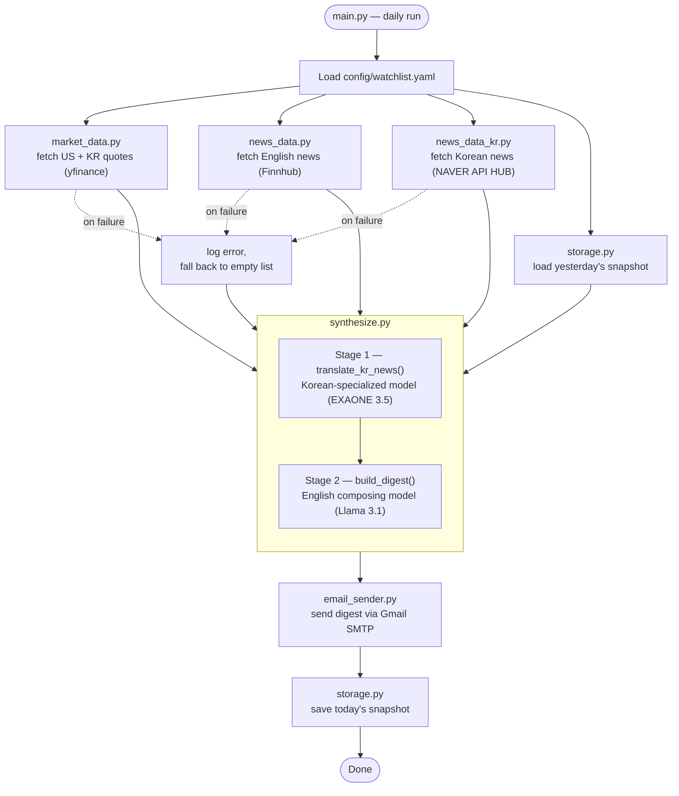

# DailyMarketDigest

A scheduled pipeline that pulls US + Korean market data and news, synthesizes it into a
digest with an LLM, and emails it every morning.

- **Stack**: plain Python + cron/launchd (a deterministic pipeline, not an autonomous agent — see [Notes](#notes--things-to-revisit-later) for why)
- **Markets covered**: US (S&P 500, Nasdaq, Dow + your watchlist) and Korea (KOSPI, KOSDAQ + your watchlist)
- **News**: English via Finnhub (real-time, ticker + market-category news), Korean via Naver Search API — folded into one English-language digest
- **Synthesis**: LangChain, with a swappable LLM backend (Claude / Gemini / local Ollama). When using
  Ollama, synthesis runs as two stages on two different local models: a Korean-specialized model
  translates the Korean news, then a strong English model composes the full digest.
- **Delivery**: email via Gmail SMTP
- **Schedule-aware**: sends a different email format depending on the day — see
  [Day-of-week behavior](#day-of-week-behavior)

## Process Flow



`Stage 1` only runs as a separate model call when `LLM_PROVIDER=ollama` (EXAONE → Llama 3.1
handoff, see [Dual-model synthesis](#dual-model-synthesis-ollama-only)). With `claude` or
`gemini`, both stages collapse into a single call on the one configured model. A failure in
any data-fetch step is logged and falls back to an empty result rather than stopping the
run — only a failure in the final email send aborts the whole pipeline. This diagram shows
the Tue–Sat path specifically — see the next section for Sunday/Monday.

## Day-of-week behavior

Both markets are closed Sat/Sun, and the US session for "today" hasn't opened yet by 7 AM
KST Monday (it opens ~11:30 PM KST) — so a plain daily digest on those two days is either a
duplicate of Saturday's (Sunday: nothing changed) or misleadingly stale (Monday: shows
Friday's close as if current). `main.py` picks the format by weekday instead:

| Day | Email | Built by |
|---|---|---|
| Tue–Sat | Regular daily digest | `synthesize.build_digest()` |
| Sunday | **Weekly Recap** — this Friday vs. last Friday's close, aggregated headlines from the week (`data/snapshots/*.json`) | `weekly.build_weekly_summary()` |
| Monday | **Week Ahead** — last Friday's closing levels (clearly labeled as such), confirmed earnings this week for US watchlist tickers (`src/earnings_calendar.py`, Finnhub), today's news | `weekly.build_week_ahead()` |

Both variants reuse the exact same visual style (`src/formatting.py`) as the daily digest,
just with different sections/headers, and both still save a snapshot at the end so Tuesday's
day-over-day framing keeps working uninterrupted. Same anti-hallucination approach as the
daily digest: all prices/dates are rendered directly from fetched data, and the LLM is only
ever asked to write commentary grounded in what it was actually given.

## Project Structure

```
DailyMarketDigest/
├── .env                      # secrets (gitignored, not committed)
├── .env.example               # template — copy to .env and fill in
├── .gitignore
├── requirements.txt
├── config/
│   └── watchlist.yaml        # holdings, indices, news keywords (edit this to customize)
├── src/
│   ├── config_utils.py       # tickers() - extracts ticker symbols from watchlist holding entries
│   ├── market_data.py        # fetch_quotes() via yfinance (US + KR tickers)
│   ├── news_data.py          # fetch_all() English headlines via Finnhub (company + general news)
│   ├── news_data_kr.py       # fetch_all_kr() Korean headlines via Naver Search API
│   ├── earnings_calendar.py  # fetch_upcoming_earnings() via Finnhub (US tickers only)
│   ├── storage.py            # daily JSON snapshots, load_yesterday()/load_snapshot()/save_today()
│   ├── llm_provider.py       # get_chat_model(role) factory: claude | gemini | ollama (role picks the Ollama model)
│   ├── formatting.py         # shared pure-Python rendering helpers (used by synthesize.py + weekly.py)
│   ├── synthesize.py         # 2-stage LCEL: translate_kr_news() -> build_digest() -> daily digest
│   ├── weekly.py             # build_weekly_summary() (Sunday) + build_week_ahead() (Monday)
│   └── email_sender.py       # send_email() via Gmail SMTP
├── data/
│   ├── snapshots/            # one JSON file per day (gitignored)
│   └── digest.log            # run log (gitignored)
├── main.py                   # orchestrates the full daily pipeline
└── run.sh                    # cron/launchd entry point
```

## Setup

1. **Install dependencies** (already done if you're picking this up fresh, otherwise):
   ```bash
   python3 -m venv .venv
   source .venv/bin/activate
   pip install -r requirements.txt
   ```

2. **Configure secrets**: copy `.env.example` to `.env` and fill in the values you need
   (see [Credentials](#credentials-needed) below — you don't need all of them, only the
   ones matching your chosen `LLM_PROVIDER`).

3. **Edit your watchlist**: `config/watchlist.yaml` ships with placeholder holdings
   (`AAPL`, `MSFT`, `SPY`, Samsung Electronics, SK Hynix). Replace with your own —
   Korean tickers need a `.KS` (KOSPI) or `.KQ` (KOSDAQ) suffix, e.g. `005930.KS`.
   Each `watchlist_us`/`watchlist_kr` entry is a small object, not a bare ticker string:
   ```yaml
   watchlist_us:
     - ticker: AAPL
       buy_date: 2026-01-15   # optional
       buy_price: 150.00      # optional
       shares: 10              # optional
       cost: 1512.50           # optional - entered separately, not computed, so it can include fees
   ```
   Only `ticker` is required. The rest are stored for a future gain/loss feature and don't
   affect the emails yet. (Data-fetching code reads just the ticker via
   `src/config_utils.py`'s `tickers()` helper.)

## Credentials needed

| Secret | Where to get it | Required for |
|---|---|---|
| `FINNHUB_API_KEY` | [finnhub.io](https://finnhub.io/register) free tier signup | English news (real-time, 60 calls/min) |
| `NAVER_CLIENT_ID` / `NAVER_CLIENT_SECRET` | [developers.naver.com](https://developers.naver.com) → register an app → enable the Search API | Korean news |
| `ANTHROPIC_API_KEY` | [console.anthropic.com](https://console.anthropic.com) | only if `LLM_PROVIDER=claude` |
| `GEMINI_API_KEY` | [aistudio.google.com](https://aistudio.google.com) | only if `LLM_PROVIDER=gemini` |
| — (local install) | [ollama.com](https://ollama.com), then `ollama pull exaone3.5:7.8b` and `ollama pull llama3.1:8b` | only if `LLM_PROVIDER=ollama` |
| `GMAIL_ADDRESS` / `GMAIL_APP_PASSWORD` | Google Account → Security → App Passwords (needs 2-Step Verification enabled) | sending the digest |

`market_data.py` needs no key — it uses `yfinance` (Yahoo Finance), which is free and
unauthenticated for both US and Korean tickers.

`DIGEST_RECIPIENT` accepts a comma-separated list to send the digest to multiple people,
e.g. `DIGEST_RECIPIENT=you@example.com,other@example.com`.

## Running manually

```bash
source .venv/bin/activate
python main.py
```

Each module can also be run standalone to sanity-check just that piece, e.g.:

```bash
python -m src.market_data       # print live quotes for your configured tickers
python -m src.news_data         # print English headlines (needs FINNHUB_API_KEY)
python -m src.news_data_kr      # print Korean headlines (needs Naver keys)
python -m src.earnings_calendar # print this week's confirmed earnings for your US watchlist
python -m src.llm_provider      # sanity-check the configured LLM backend
python -m src.synthesize        # build a sample daily digest with real prices + fake news
python -m src.weekly            # build sample Weekly Recap + Week Ahead emails
```

A single failed step (e.g. a missing news API key) logs an error and falls back to an
empty result rather than crashing the whole run — you'll still get a digest, just with
that section thin, until you add the missing key.

## Scheduling (not yet set up)

`run.sh` is the entry point cron/launchd should call — it `cd`s into the project,
activates the venv, runs `main.py`, and appends output to `data/digest.log`.

**cron** (`crontab -e`), e.g. to run at 7:00 AM daily:
```
0 7 * * * /Users/seunglee/works/DailyMarketDigest/run.sh
```

**launchd** is generally more reliable on macOS (cron jobs can silently fail to fire
due to sleep/permissions). If you'd rather use that, say so and I'll generate the
`.plist` file and load it — just let me know your preferred run time and I'll wire it up.

## Switching LLM providers

Change one line in `.env`:
```
LLM_PROVIDER=claude   # or: gemini | ollama
```
No other code changes needed — `src/llm_provider.py` handles the swap.

## Dual-model synthesis (Ollama only)

When `LLM_PROVIDER=ollama`, synthesis runs as two sequential stages instead of one call,
each on a different local model — `get_chat_model(role)` in `src/llm_provider.py` picks
the model by role:

1. **`translate_kr_news()`** (role `"kr"`) — translates/summarizes the Korean headlines
   into English bullets. Uses `OLLAMA_MODEL_KR` (default `exaone3.5:7.8b`, LG's
   Korean-English bilingual model — chosen because it's purpose-trained on Korean rather
   than treating it as one of many secondary languages).
2. **`build_digest()`** (role `"en"`) — writes the full digest from US/KR market data,
   English news, and stage 1's translated Korean summary. Uses `OLLAMA_MODEL_EN` (default
   `llama3.1:8b` — stronger general English instruction-following/writing quality).

The two models are never loaded simultaneously — Ollama loads one, runs it, and swaps to
the other for the next stage, which is why this works fine on 16GB of unified memory.
For `claude`/`gemini`, `role` is ignored and the single configured model handles both
stages (no split needed — hosted frontier models are already strong at Korean).

To use different local models, override in `.env`:
```
OLLAMA_MODEL_KR=exaone3.5:7.8b
OLLAMA_MODEL_EN=llama3.1:8b
```

## Notes / things to revisit later

- **Why "Digest" and not "Agent"**: this is a fixed, deterministic pipeline (same steps,
  same order, every run) with an LLM invoked as a subroutine for writing — it doesn't
  perceive changing conditions, choose its own tools, or act autonomously toward a goal,
  which is what "agent" implies. That was a deliberate choice (see the [Process Flow](#process-flow)
  above): a scheduled daily report doesn't benefit from an LLM deciding what to fetch: predictability
  matters more here. A genuinely agentic version of this project would be a separate,
  interactive system built on the same data modules (`market_data.py`, `news_data.py`,
  `news_data_kr.py`) with real tool-calling and reasoning — not a change to this pipeline.
- Snapshots (`data/snapshots/*.json`) currently only feed a yesterday-vs-today diff into
  the prompt; there's no multi-day trend analysis or queryable database — decided against
  for now, revisit if you want richer historical context later.
- Korean headlines are summarized/translated into English before reaching the final digest
  rather than kept bilingual — if you'd prefer a Korean-language section too, that's a
  prompt change in `src/synthesize.py`.
- Output quality is best with Claude/Gemini. With Ollama, the composing model (`OLLAMA_MODEL_EN`)
  can sometimes invent a plausible-sounding but inaccurate cause for a price move instead of
  sticking strictly to the fed-in headline — worth spot-checking digests occasionally,
  especially with smaller local models.
- `main.py` aborts (rather than falling back) if the email step itself fails, since a
  digest that isn't delivered isn't useful — check `data/digest.log` if a scheduled run
  produces no email.
